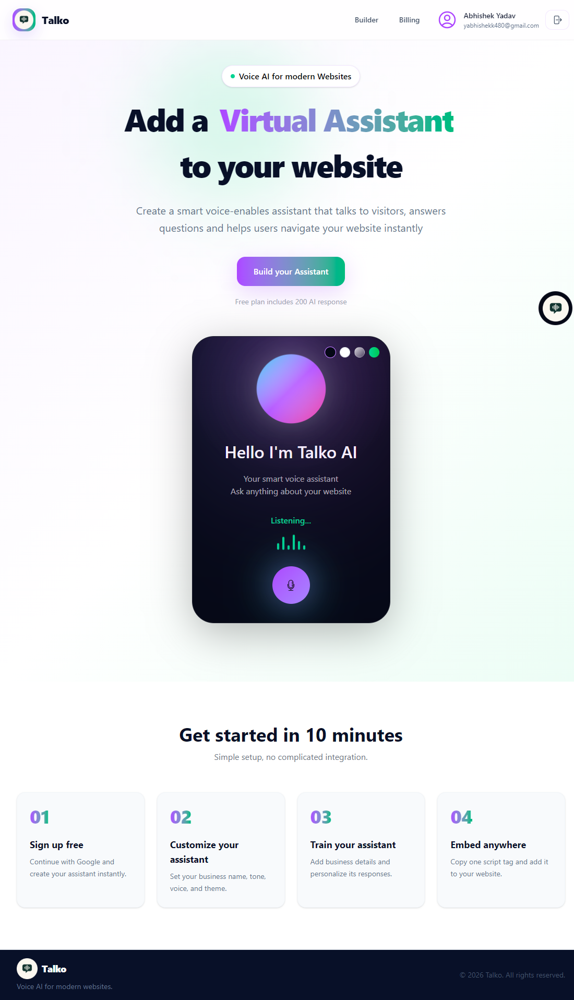
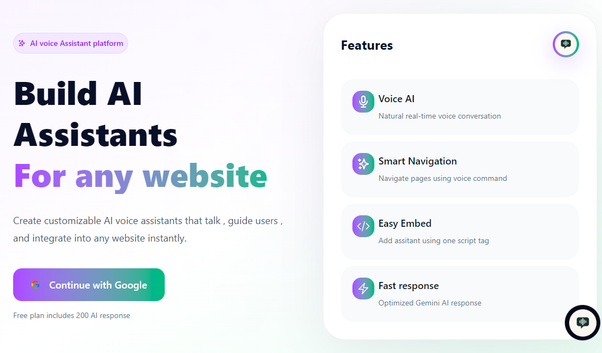
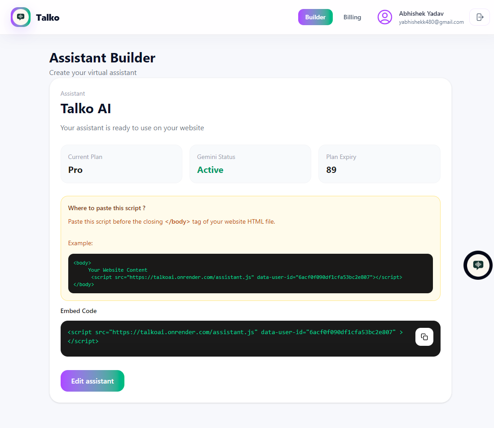
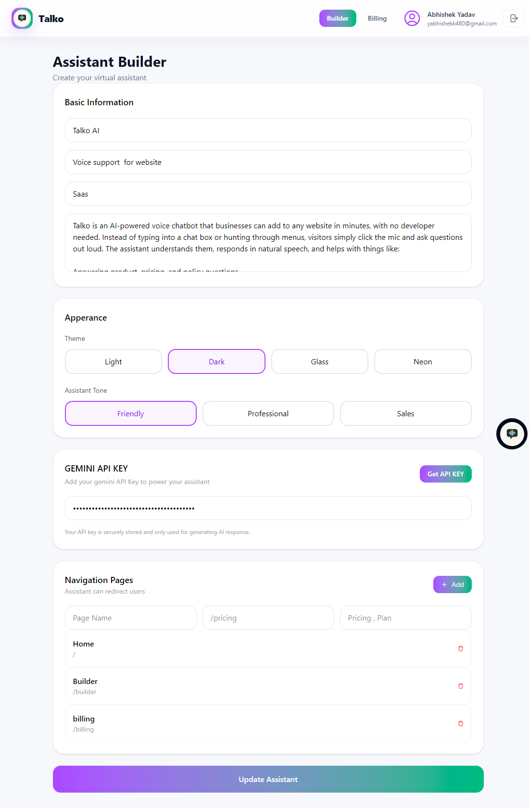
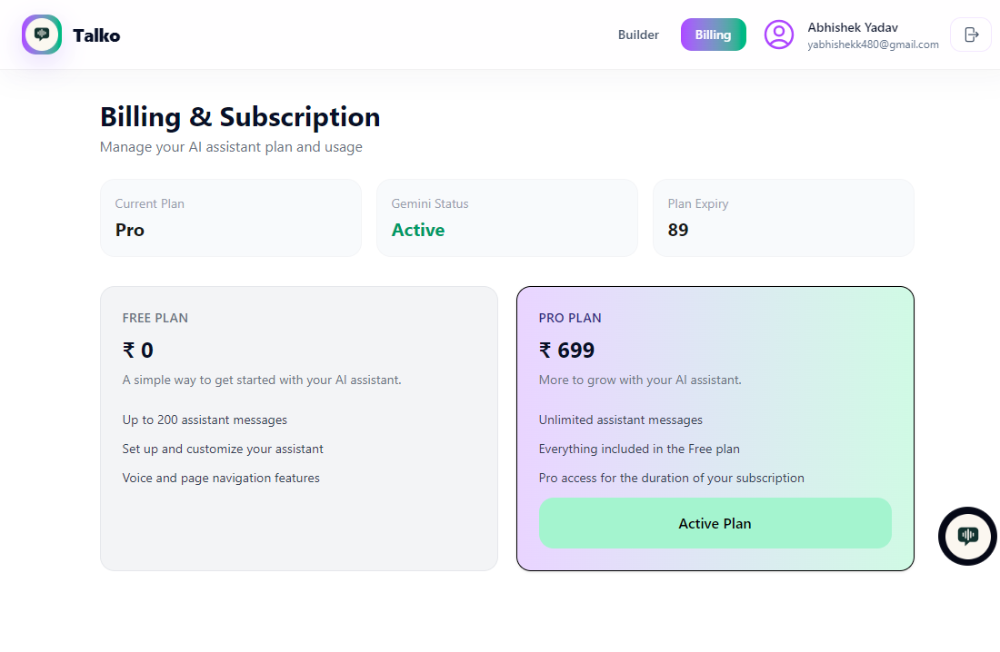
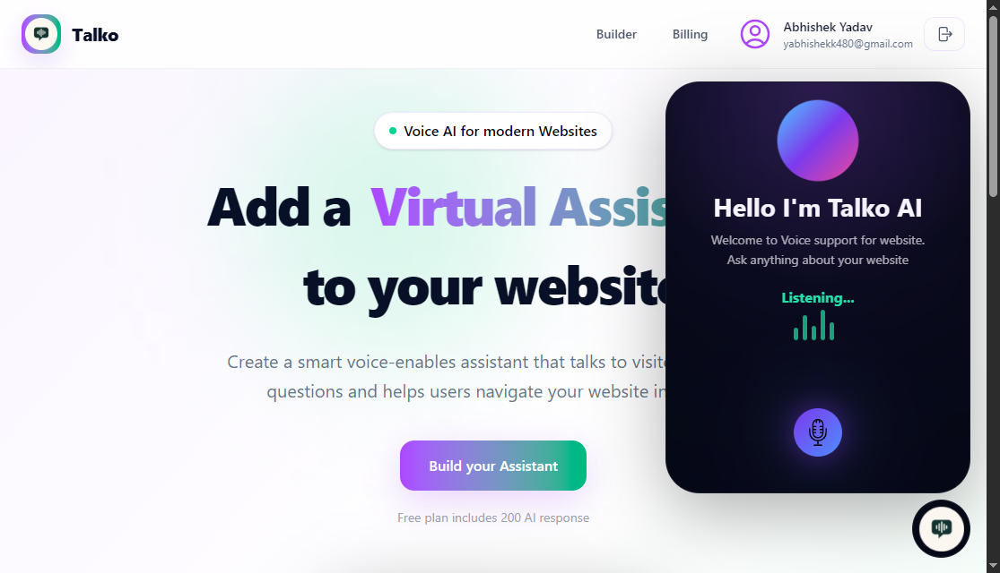

# Talko

Talko is an AI-powered website assistant platform that lets businesses create a custom voice-enabled virtual assistant for their website. Users can configure the assistant, add page-specific knowledge, integrate Gemini AI, and embed the assistant with a single script snippet.

This project contains both the backend API and the frontend dashboard used to manage the assistant, billing, and authentication flow.

## Features

- Google-based user authentication
- AI assistant configuration with business name, tone, theme, and description
- Page-aware website context management for assistant responses
- Gemini API integration for AI-powered conversations
- Voice-friendly assistant interface for website visitors
- Billing and subscription flow with Razorpay
- Responsive React dashboard for setup and management
- Script-based embedding for any website

## Tech Stack

### Frontend
- React + Vite
- Tailwind CSS
- Firebase Authentication
- React Router
- Axios

### Backend
- Node.js + Express
- MongoDB with Mongoose
- JWT-based cookie authentication
- Razorpay payment integration
- Gemini AI support 


## Authentication & Billing

- Google login is handled using Firebase authentication.
- The backend creates a session using JWT cookies.
- Protected routes ensure only authenticated users can access the dashboard.
- The billing section supports a Pro plan purchase using Razorpay.

## Embedding the Assistant

Once the user configures the assistant, the builder generates a script tag like this:

```html
<script src="https://talkoai.onrender.com/assistant.js" data-user-id="USER_ID"></script>
```

This script is meant to be placed before the closing `</body>` tag in the website HTML.

## Screenshots

### Home


### Login


### Assistant Builder


### Assistant Configuration


### Billing


### Chatbot


## License

This project is currently licensed under the ISC license as declared in the server package configuration.

## Author

Built for AI-powered website assistants and business automation.
